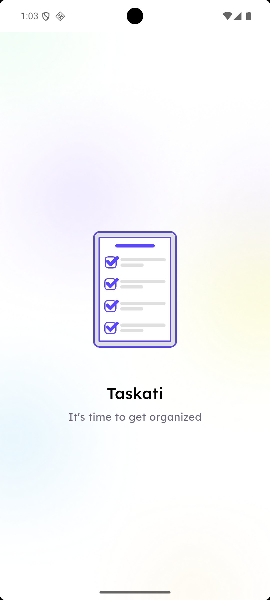
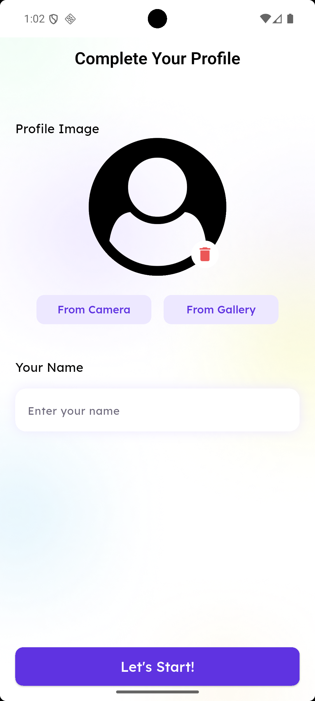
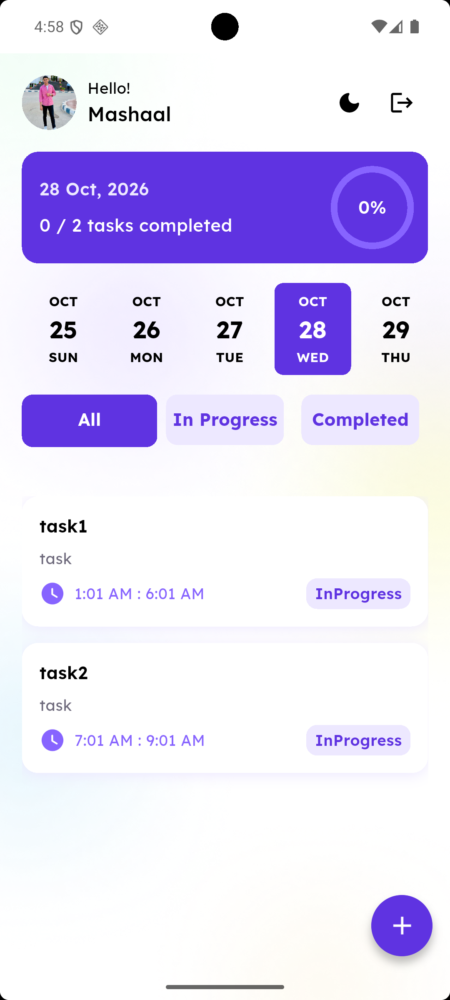
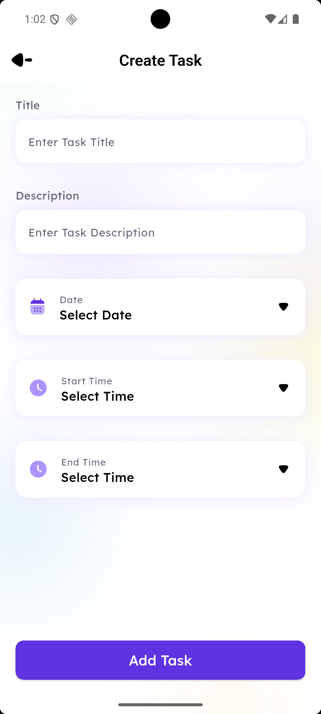
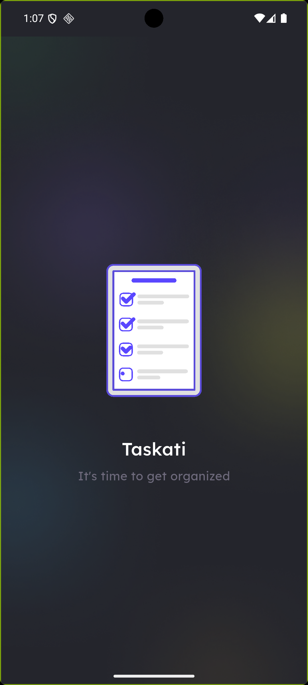
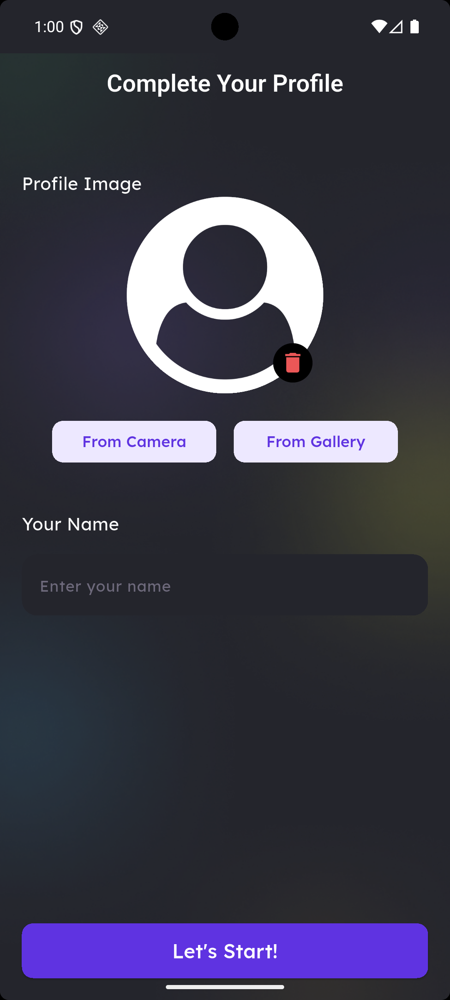
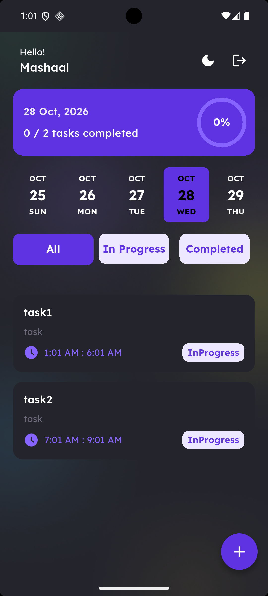
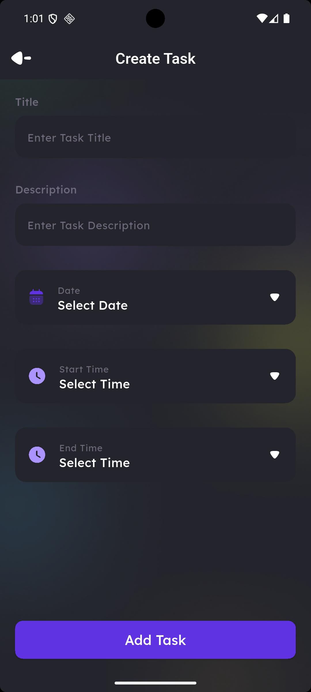

# Taskati 📋✨
  Taskati is a simple Flutter task-management app that helps users organize their daily tasks. It allows users to create and edit tasks, select dates and times, track progress, switch between light and dark themes, and customize their profile with a name and photo. User data is stored locally using Hive.

## ✨ Features

* 📋 **Task Management:** Create, organize, and manage daily tasks.
* 💾 **Local Storage:** Store task data locally using Hive CE.
* 🌙 **Light & Dark Mode:** Switch between light and dark themes.
* 🎨 **Custom UI:** Modern interface with customized themes and styling.
* 🖼️ **Image Selection:** Select images using the Image Picker package.
* 📅 **Date Selection:** Select dates and format them for better task organization.
* 🎬 **Smooth Animations:** Enhance the user experience with Lottie animations.
* 📊 **Progress Indicators:** Display progress using Percent Indicator.
* 👆 **Interactive Actions:** Improve task interactions using Flutter Slidable.
* 📱 **Cross-Platform Development:** Built with Flutter for mobile applications.

## 🛠️ Tech Stack

* **Framework:** Flutter
* **Programming Language:** Dart
* **Local Storage:** Hive CE
* **Animations:** Lottie
* **Icons & Graphics:** Flutter SVG
* **Image Handling:** Image Picker
* **Date Formatting:** Intl
* **Date Selection:** Date Picker Timeline
* **Interactive UI:** Flutter Slidable
* **Progress Visualization:** Percent Indicator

## 📸 App Screenshots

### ☀️ Light Mode

|                 Splash Screen                 |                  Profile Screen                 |                Home Screen                |                       Create Task                       |
| :-------------------------------------------: | :---------------------------------------------: | :---------------------------------------: | :-----------------------------------------------------: |
|  |  |  |  |

### 🌙 Dark Mode

|                Splash Screen                |                 Profile Screen                |               Home Screen               |                      Create Task                      |
| :-----------------------------------------: | :-------------------------------------------: | :-------------------------------------: | :---------------------------------------------------: |
|  |  |  |  |

> **Note:** Replace the screenshot paths above with your actual application screenshots. You can also add more screens to showcase the app.


## 📁 Project Structure

```text
taskati
├── assets/
│   ├── images/
│   ├── icons/
│   ├── lottie/
│   └── fonts/
├── lib/
│   ├── core/
│   │   ├── constants/
│   │   ├── functions/
│   │   ├── hive/
│   │   ├── models/
│   │   ├── services/
│   │   ├── styles/
│   │   └── widgets/
│   ├── features/
│   │   ├── create_task/
│   │   ├── home/
│   │   ├── splash/
│   │   └── upload/
│   └── main.dart
├── pubspec.yaml
└── README.md
```

